<div align="center">

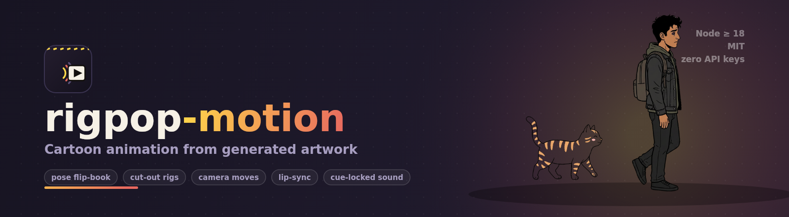

**Vector or AI-painted character rigs on one IK skeleton · an always-alive motion system · pose packs · stage-direction scripts.**
Write a short like a screenplay; get a 720×1280 reel with voices, captions and cue-locked sound.

<br>

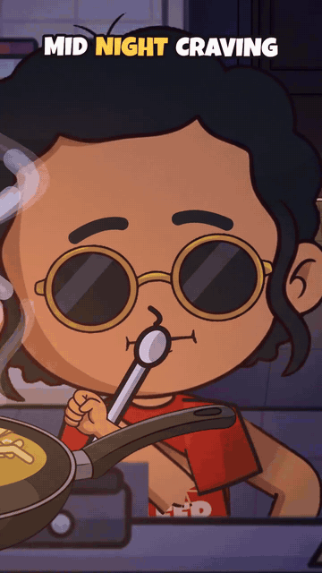
&nbsp;
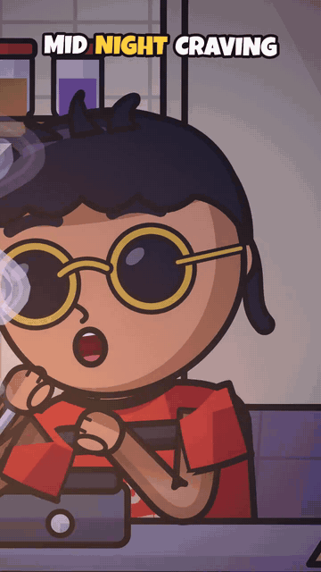

<sub>v3 (left): painted parts, painted set, a pose-pack jump · v2 (right): everything drawn in code</sub>

<br><br>

[**▶ Watch “Midnight Maggi” v3 (40 s)**](out/midnight-maggi-v3.mp4) &nbsp;·&nbsp;
[v2 cut](out/midnight-maggi.mp4) &nbsp;·&nbsp;
[v3: hybrid image rig](#-v3-hybrid-image-rig-auto-rig-and-pose-packs) &nbsp;·&nbsp;
[Script format](#-the-script-is-the-animation) &nbsp;·&nbsp;
[Quickstart](#-quickstart) &nbsp;·&nbsp;
[What makes it move](#-what-makes-it-move) &nbsp;·&nbsp;
[v1 docs](#-v1--motion-comic-from-generated-artwork)

<br>


</div>

---


> **Agents and contributors:** read [AGENTS.md](AGENTS.md) first. The rule is pose first, motion second: generate drawn key poses, then animate smooth eased transitions between them. No puppet limb swings, no visible joints.

## 🧩 v3: hybrid image rig, auto-rig and pose packs

v1 used whole AI paintings of a character, and a painting can't bend, so the shorts were stiff.
v2 drew everything in code so it could act. v3 brings the paintings back **without losing the
motion**. The image model paints the *parts*, the engine rigs them itself, and the v2 skeleton
moves them. When a move is too big for a puppet, the model paints a few full-body *key poses*
and the engine plays them as a flip-book inside the shot.

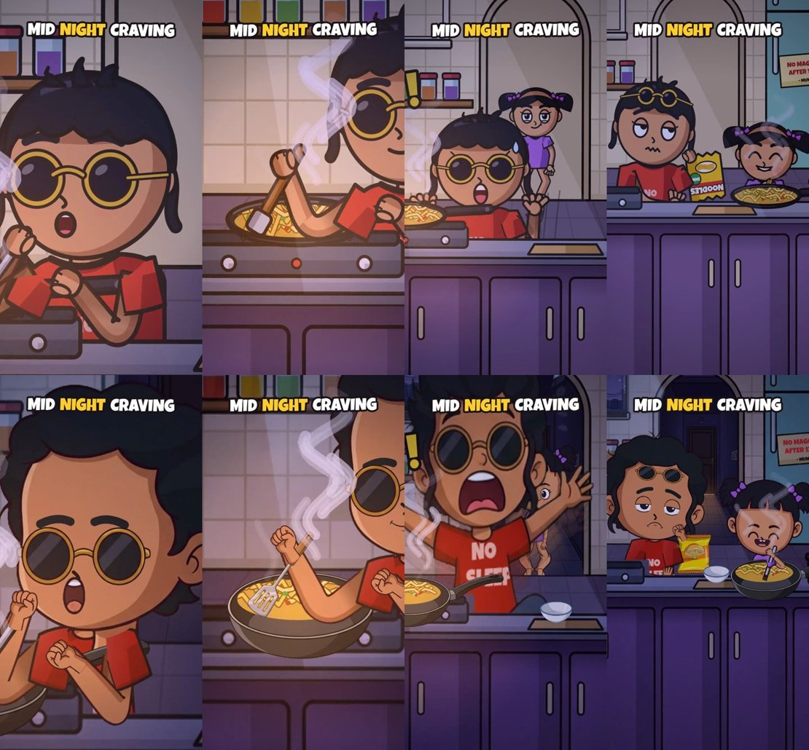

<sub>The same script beats in v2 (top) and v3 (bottom): ECU, insert on the pan, the startled jump, the payoff two-shot.</sub>

### Pose packs keep their faces

A pose pack replaces the whole drawing for the length of its clip, which means the rig's own face
stack — blinks, eye darts, lip-sync — is not drawn while it plays. Every pack therefore ships a
patch set next to its keys:

```
characters/<name>/poses/<action>/key0.png           the drawn pose
                              key0.blink.png        lids, pasted when the blink curve fires
                              key0.m.rest|M|A|O|E.png   the rig's mouth shapes on this drawing's own skin
```

`rigpop-motion poses` writes them automatically (`src/v3/facepatch.mjs`); re-run them by hand with
`rigpop-motion faces <character> [pose]` after a pack is rebuilt. Two details make the mouth read as
part of the drawing instead of a sticker: the patch is filled with the skin colour sampled just
outside it, row by row, so the drawing's shading runs through unbroken; and the lips are placed
under the moustache/upper-lip ink rather than over it.

Pose keys also carry the rig's always-on idle, and a living-pose warp: the head band is tipped about
the neck and the body leans about the hip, with the blink/mouth patches inside the same transform.
A held drawing therefore keeps breathing, nodding and turning instead of freezing.

**A character with no art of its own is pose-only.** If a `rig.json` borrows another character's part
files (a path like `../bunty/parts/torso.png`) or sets `"poseOnly": true`, the engine treats it as
pose-only: it holds `rig.defaultPose` (else `idle`) whenever no pose-pack clip is running and never
assembles the puppet, because that puppet would be *the other character* on screen. Name your own
`defaultPose` in `rig.json` for a character that should stand in something other than `idle`.

### A whole reel with no puppets: “Chappal Pro Max”

`scripts/chappal-pro-max.md` (32 s, 12 lines) is the worked example of the strict version of the
rule: **two characters, four full-body drawn poses each, zero skeleton**. No part assembly, no IK,
no blends — the drawing is swapped on a hard cut and the camera, breath, blinks and mouth carry the
life. Poses are chosen by the emotion of the line (`listen` / `think` / `point` / `explain`) and
held per beat with `[P poses point 60s &]`, so nothing rotates through a loop.

Three lessons from that reel, all of them written up in
[docs/CHAPPAL-PRO-MAX.md](docs/CHAPPAL-PRO-MAX.md):

* a pack with no `parts/mouth.{A,E,M,O}.png` renders perfectly and never moves its mouth —
  `face.mouth.files` comes back `{}`;
* `[shot medium K]` centre-crops a vertical frame and puts the head off-screen; author it as
  `[shot at <x> <y> <zoom>]` and stay in the 2.0–2.4× range;
* `[<actor> poses <pack> <n>s &]` — the `&` runs the clip *alongside* the line instead of between
  lines, naming a pack pins the actor to that one drawing, and leaving the name out
  (`[<actor> poses 60s &]`) cycles the emotion's own vocabulary instead, with `talk` carrying the
  lip-sync. Pick one per beat, or a beat can land on a pose the script never asked for.

`rigpop-motion qa [character|script.md]` is the gate for all of this. A pose key with no face patch is
a **failure** — that is the silent bug where a character animates perfectly and never blinks or
speaks. It also checks patch rects against the key image, face-size and skin-tone drift across a pack,
and that every `[<actor> pose-pack <name>]` in a script resolves on that actor's rig.

### 1 · Painted set, split into parallax plates

The v2 kitchen is rendered without its cast and given to the image model as a **layout guide**,
together with the style reference. The model repaints it, keeping every landmark where the
engine expects it: arch, window, fridge, counter line, stove. `rigpop-motion set` then splits that
one painting into layers. Each layer moves at its own rate with the camera:

| layer | from | parallax |
|---|---|---|
| night sky (through the window glass) | its own generation | 0.55 |
| hallway with the bedroom-door glow (through the arch) | its own generation | 0.82 |
| back wall, arch cut out, glass thinned | the guided repaint | 1.0 |
| fridge open, with and without the stash | a guided edit, cross-faded by `fridge` state | 1.0 |
| counter + stove band, drawn over the cast | masked from the same repaint | 1.0 |
| hanging utensils | chroma-keyed generation | 1.35 |

Props (pan, noodle packet, spatula, bowl) come from one chroma sheet, keyed to transparent PNGs.
The image model draws no text, so the code adds it: the fridge note, and the `NO SLEEP` print
baked onto the painted tee.

### 2 · `rigpop-motion rig <character>`: auto-rigging from part sheets

```
characters/kabir/
  rig-src.json      style bible, prompts, sheet files, a reading-order label manifest
  sheets/           model.png · head.png · body.png · face.png   (image model, chroma green)
  parts/            25 transparent parts, limbs turned upright
  rig.json          pivots, face anchors, sampled skin/hair colours, base skeleton
  rig-preview.jpg   every part with its pivots marked
```

1. **Generate.** Every sheet prompt repeats the same style bible. The model sheet is passed as a
   reference to every part sheet, and the head sheet to the face kit, so all the parts match.
   Head sheet: front and ¾ heads with a *blank face*, plus the sunglasses. Body sheet: torso,
   upper arm, forearm, three hands, thigh, shin, foot, each limb drawn vertical. Face kit: eye
   pairs (open, half, closed, happy) and mouths (A, E, O, M, smile, laugh, frown, smirk).
   `rigpop-motion rig kabir --prompts` prints them.
2. **Auto-cut.** Key the screen (by greenness, so the model's soft ground shadows go too), then
   find connected components. Specks and the labels the model writes anyway are dropped. Stray
   bits (a lash flick, a hair strand) join their part, and the sheet is read in rows. The
   manifest only says what was drawn in reading order: `"eyes.open*2"` means two items form one
   part, and `"mouth.laugh>0.47"` means keep the bottom of it. Each part gets a 1 px erode and a
   re-inked edge, so no green halo is left. Face patches have their skin lifted out, so the head's
   own skin shows through and a patch edge can never show.
3. **Auto-pivot.** Each limb is turned upright along its principal axis. Each joint sits one
   end-radius inside the end, so the rounded caps overlap the next part. Hands get a wrist,
   the foot an ankle and sole line. The torso gets neck, shoulders and hip from its silhouette.
   Any sleeve flaps the model painted are trimmed back, and **proper sleeves are painted into the
   torso** (`src/v3/sleeves.mjs`): a sloped shoulder line, a short tube and a hem, in the
   shirt's own colours. The head gets its face ellipse from the blank skin.
4. **Map onto the v2 skeleton.** Bones keep their v2 lengths, so every v2 action, IK target,
   idle and lip-sync works unchanged. The shoulders move to where the painted torso has them.

**No puppet shoulders.** A sleeve never rides on the arm, so a swinging arm can't make a puffy
shoulder cap pop off the body. The arm is **one bare, tapered skin strip** (sleeve to wrist, no
bulge at the shoulder or elbow) that starts *under* the sleeve opening with its root shaded,
and the sleeve is drawn again over it so the joint is never on screen. The forearm and hand are
then redrawn on top, so a forearm folded across the chest is never swallowed by its own sleeve.
The shoulder only swings inside the range the sleeve can hide (never above the shoulder line).
The v2 vector rig works the same way: sleeves are part of the torso drawing, arms taper and
tuck in. Idle hands at the counter tuck below its front edge instead of sitting there as lumps.

**How a painted elbow bends.** The arm strip (and the thigh + shin strip, composed child-first
with the parent trimmed at the joint so its cap never draws a seam line) is laid along the IK
chain slice by slice, and the joint is a smooth curve. The elbow or knee bends like
rubber-hose, the texture follows the bone, and nothing can come loose.
Torso, head, hands and feet are rigid sprites on the solved joints. Eyes and mouths are pasted
patches driven by the same blinks, lids and visemes as v2. Brows, nose, blush, sweat and neck stay
thin vector ink.

```yaml
cast:
  K: { rig: image:characters/kabir, name: Kabir, voice: hi-IN-MadhurNeural }   # painted parts
  C: { rig: vector:chhoti, name: Chhoti, voice: hi-IN-SwaraNeural }            # the v2 rig
```

### 3 · `rigpop-motion poses <character> <action>`: pose packs

For the moves a puppet can't sell, the model paints 4–8 full-body keys of the same character.
Full drawn poses read better than puppet arm swings, so the v3 reel leans on them: the
"Mission..." hand-rub into a fist pump (5 poses), the belly laugh (7), and the startled jump (6). `poses` cuts them and evens out the model's size drift by measuring
each face. It puts every pair of feet on one floor line and sizes the pack from the standing
key, so it matches the puppet exactly. In the script it is one verb:

```markdown
C (naughty): Bhaiyaaa...
[K pose-pack jump 1.1s &] [camera shake 0.5s 26 +0.65s]
```

Keys hold on twos with per-key timing. The lift arc is eased (anticipation, ballistic air,
landing squash). Fast moves get smear in-betweens: stretched ghost trails plus speed lines.
Camera, shake, exclaim marks and SFX are cue-locked as usual. While the pack plays, the
puppet keeps solving underneath, so framing and FX anchors don't jump.

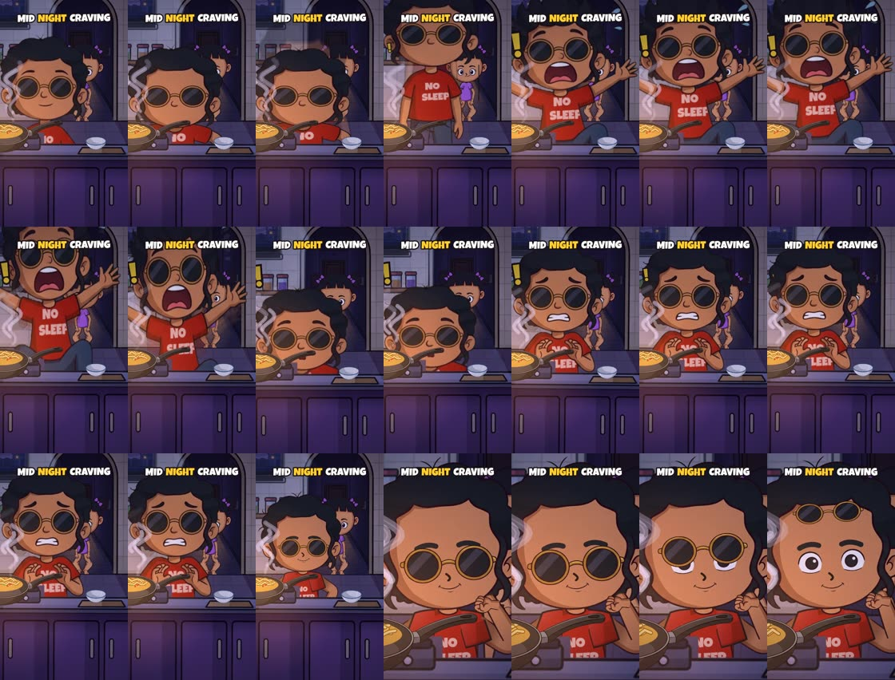

<sub>1.4 s of `out/midnight-maggi-v3.mp4` at 15 fps: rest, anticipation squash, take-off, mid-air fright with smear, landing, the scared recover, then the cut to ECU.</sub>

### Run it

```bash
npx rigpop-motion set                                   # plates + props from assets/v3/night-kitchen/src
npx rigpop-motion rig kabir && npx rigpop-motion rig chhoti
npx rigpop-motion poses kabir jump
npx rigpop-motion render scripts/midnight-maggi-v3.md -o out/midnight-maggi-v3.mp4 --crf 25
npx rigpop-motion render scripts/midnight-maggi-v3.md --part 1/3 -o out/x.mp4   # long renders in parts…
npx rigpop-motion render scripts/midnight-maggi-v3.md --mux 3 -o out/x.mp4       # …then concat + audio
npx rigpop-motion strip  scripts/midnight-maggi-v3.md -t 26.3 -n 8 -o out/strip.jpg  # consecutive frames
```

The v3 reel renders at about **14 fps** on a 2-core sandbox (v2: about 15). The 40 s, 1,199-frame
reel takes 84 s and comes out at 6.1 MB. The v3 CLI renders v2 scripts pixel-identically.

### v2 or v3? Honest notes

- **Richer:** textured hair, painted fabric folds and sneakers, a lit, detailed kitchen with real
  depth, and expressive painted mouths and eyes. The jump reads much bigger as a pose pack.
- **Still v2's strengths:** hair has no secondary motion in v3 (no flop, no pigtail swing).
  Chhoti's brows are painted into her eye patches, so they can't act. A ¾ head is a swap, not a
  turn. Extreme close-ups are softer, because a ~450 px painted head is scaled up to 2–3× where
  vectors stay crisp. The over-the-shoulder back view is a flat silhouette of the painted parts.
- **Pose packs** are holds: between keys only the arc, squash and smears move, and the model's
  "take-off" key isn't as stretched as asked. Its tee print is re-added in code, and hands can
  cover it.
- **Generation is outside the CLI.** `rig --prompts` and `poses --prompt` print what to ask any
  image model; this repo's sheets were made with Hark's image tool. The label manifest records
  what the model actually drew, because it rarely keeps a requested grid exactly.

Mix freely: each cast entry picks `image:` or `vector:`, and each script picks
`scene: painted-night-kitchen` or `night-kitchen`.

---

## 🎬 v2: from motion comic to cartoon

v1 made shorts out of painterly AI stills: a mouth patch, a slow zoom, a few pose cards
crossfaded. It looked like a motion comic, because it was one, and the characters barely moved.

v2 throws the stills away. Every character, prop and set is **drawn in code** with
`@napi-rs/canvas` paths in a flat Indian-cartoon look: bold outline, flat fill, one cel shadow.
Because the character is a rig and not a picture, it can **actually act**. It stirs, shakes
the packet, sprinkles masala, tastes, laughs, sneaks and jumps out of its skin. It breathes and
blinks the whole time.

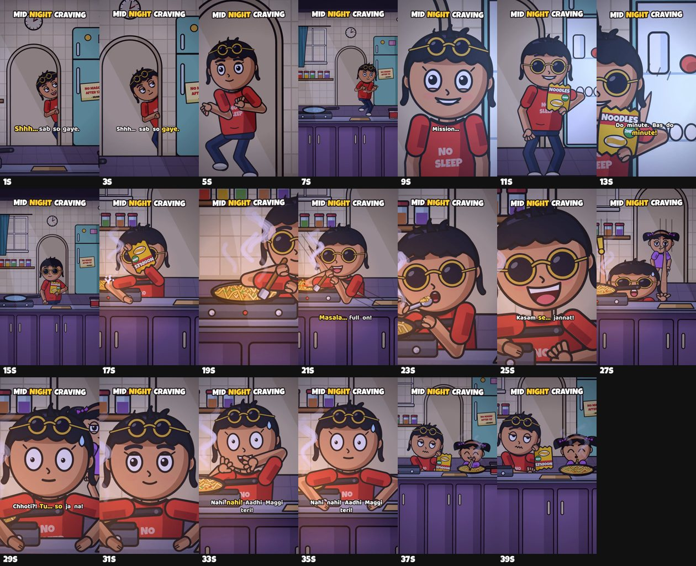

<sub>One frame every 2 s of `out/midnight-maggi.mp4`: peek, whip-pan, sneak, fridge glow,
ECU, insert, cook, taste, laugh, the sister, the jump, close-ups, the payoff two-shot.</sub>

---

## 📝 The script is the animation

A short is a readable markdown file, not a thousand lines of drawing code. This is a real
excerpt from [`scripts/midnight-maggi.md`](scripts/midnight-maggi.md):

```markdown
---
title: MID NIGHT CRAVING
highlight: NIGHT
size: 720x1280
fps: 30
on_twos: true
music: assets/maggi/bed.m4a
cast:
  K: { rig: kabir, name: Kabir, voice: hi-IN-MadhurNeural, rate: +8% }
  C: { rig: chhoti, name: Chhoti, voice: hi-IN-SwaraNeural, pitch: +45, rate: +6% }
---

# 4 · Cook
[shot medium K]
[stove on]
[K drop-noodles 1.4s]
[shot insert pan]
[K stir 2.2s]
[shot medium K]
[K sprinkle 1.3s]
[K stir 2.6s &]
K (happy): Masala... full on!
[shot ecu K]
[K taste 2.4s]
[camera push 1.18x 0.5s]
[K laugh 1.8s &]
K (laugh): Kasam se... jannat!

# 5 · Caught
[C place arch]
[shot two K C]
C (naughty): Bhaiyaaa...
[K jump 0.9s &] [camera shake 0.5s 26]
```

You never write idle motion or lip-sync. The engine plays **breathing, sway, blinks, eye
darts, speech head-bob and visemes underneath every line** on its own.

### Directives

| Directive | What it does |
|---|---|
| `[shot wide]` `[shot medium K]` `[shot close K]` `[shot ecu K]` | hard cut; character shots frame the body so head motion reads |
| `[shot insert K R]` `[shot insert pan]` | insert on a hand (what it holds) or the pan |
| `[shot ots K C]` `[shot two K C]` `[shot at x y zoom]` | over-the-shoulder, two-shot, a custom frame |
| `[camera push 1.3x 0.6s]` `[camera shake 0.4s 20]` `[camera whip left 0.3s]` | camera moves; they never advance the clock |
| `[K place counter]` `[K walk fridge 1.5s]` `[K sneak arch 2s]` | blocking between set marks, with footsteps locked to each plant |
| `[K stir 3s]` `[K stir 3s &]` | an action; `&` runs it under whatever follows |
| `[K face sneaky]` `[K look C]` `[K hold R packet]` `[K drop R]` `[K shades down]` | state changes |
| `[stove on]` `[pan noodles]` `[pan move right]` `[fridge open]` | set state |
| `[sfx growl 0.8 +0.2s]` `[wait 0.5s]` | a sound cue, a pause |
| `K (excited): Do minute!` | a line: Edge TTS, lip-sync, word captions; the clock waits for it |

**Actions:** `stir` · `shake-packet` · `hold-packet` · `drop-noodles` · `sprinkle` · `taste` ·
`laugh` · `jump` · `peek` · `open-fridge` · `close-fridge` · `grab` · `push-shades` · `point` ·
`cover-mouth` · `hands-hips` · `eat` · `sad-shake` · `no-no` · `nod`

**Expressions:** `neutral` · `happy` · `sneaky` · `smug` · `hungry` · `excited` · `bliss` ·
`laugh` · `shock` · `scared` · `sad` · `naughty` · `angry`

**Marks** in the `night-kitchen` set: `hall` · `arch-peek` · `arch` · `back` · `back-left` ·
`fridge` · `counter` · `counter-mid` · `counter-right` · `off-left` · `off-right`

Errors point at the line: `line 6: unknown action "stirr" for K (have: stir, shake-packet, …)`.

---

## 🚀 Quickstart

```bash
npm install
npx rigpop-motion render scripts/midnight-maggi.md -o out/midnight-maggi.mp4
npx rigpop-motion still  scripts/midnight-maggi.md -t 20.3            # one PNG, instantly
npx rigpop-motion still  scripts/midnight-maggi.md --sheet 2          # contact sheet
npx rigpop-motion gif    out/midnight-maggi.mp4 -s 22.2 -d 6 -o docs/midnight-maggi.gif
```

Rendering runs at about **20 fps** on a 2-core ARM sandbox: the 40 s reel takes about a minute,
voices included (TTS is cached in `.cache/tts`). Edge TTS needs network on the first run. If
you are behind a proxy, the engine clears the proxy variables for that call only.

---

## 🦴 What makes it move

<table>
<tr><td width="50%" valign="top">

**The rig** (`src/v2/rig.mjs`)
- parented parts with pivots: ground → hip → torso → neck → head, shoulders → **2-bone IK
  arms**, hips → **2-bone IK legs**
- the elbow and knee are picked by a **pole target**, so elbows stay out and knees go forward
- limbs are drawn as rubber-hose strokes with round joins, **so a joint can't open a seam**;
  a hand is always at the end of its forearm, and an out-of-reach target clamps
- head: eyes (white, pupil, highlight, **upper and lower lids**), brows, nose, blush, sweat,
  ears, hair front and back; a **3/4 turn** slides the features
- **13 mouth shapes**: rest, smile, smirk, frown, wobble, mbp, chew, oh, ee, ah, shock, grin, laugh
- hands: open, droop, spread, fist/grip, pinch, point, flat (resting), holding any prop
- two characters: **Kabir** (big head, round gold shades, red tee) and **Chhoti** (pigtails, bows)

</td><td width="50%" valign="top">

**The motion** (`src/v2/motion.mjs`)
- **always on**: breathing, hip sway, head drift, blinks on a seeded schedule, saccadic
  eye darts, plus head-bob and brow lift driven by the voice amplitude
- **visemes** from the actual TTS audio (RMS plus zero-crossing rate)
- action clips blend in through **back-eased envelopes**, so a reach anticipates and
  overshoots
- `jump` is anticipation crouch → stretch → air → squash → spring settle
- `stir` runs an elliptical tip path with the pan handle and noodles jiggling in sync
- characters animate **on twos** (12 drawings/s); camera and FX stay on ones
- fast hands leave a **smear frame** with speed lines

</td></tr>
<tr><td valign="top">

**Props + FX** (`src/v2/props.mjs`)
- pan with wiggling noodles, bubbles and masala flecks
- a gas flame ring that flickers on noise
- procedural steam wisps
- a generic yellow 2-minute **noodles packet** (no real logo), a masala sachet, spatula,
  spoon, fork with dangling strands
- closed-form particle bursts: masala, splash, a falling noodle block
- comic "!" impact marks

</td><td valign="top">

**Set + camera** (`src/v2/scene.mjs`, `engine.mjs`)
- night kitchen drawn in code: tiles, fridge (the door swings open with a light glow and a
  "NO MAGGI AFTER 12" note), arch doorway, counter, stove, shelf of jars, ticking clock,
  window with moon and stars
- **3 parallax planes**: sky/hallway, the set, a foreground of hanging ladles
- depth: characters scale toward the back wall and step **through** the arch, which clips them
- shots, lagged follow, push/pull, **whip pan with motion blur**, shake, handheld drift
- night grade with warm stove light, cool fridge spill and moonlight

</td></tr>
</table>

### Sound

Voices are Edge neural TTS (`hi-IN-MadhurNeural`, `hi-IN-SwaraNeural` with a pitch lift), trimmed
and analysed. The music bed ducks under every line. SFX are **cue-locked by the actions
themselves**: `stir` schedules the boil and the spoon clinks, `sprinkle` the masala, `taste` the
clink, slurp and gulp, `open-fridge` the door and the hum, `sneak` a footstep on every plant, and
a whip pan its whoosh. The foil crinkle is synthesised.

### Add a character

Add an entry to `RIGS` in `src/v2/rig.mjs`: colours, head and body proportions, limb lengths,
`hairStyle` (`messy` or `pigtails`), `accessory`, and `dress`. Every action and expression works
on it straight away. Chhoti is the same rig as Kabir with different numbers.

---

## 🗺️ Roadmap

- [x] layered vector rig with IK arms and legs, pivots and parenting
- [x] always-on idle, blinks, saccades, speech-driven head and brows, visemes from audio
- [x] action clips with anticipation, overshoot, squash and stretch, smear frames, on twos
- [x] stage-direction script format + `render` / `still` / `gif` CLI
- [x] 3-plane parallax set, shot grammar (wide / medium / close / ECU / insert / OTS / two), whip pans
- [x] cue-locked SFX scheduled by the actions themselves
- [x] v3: AI-painted parts auto-rigged onto the same skeleton, painted parallax plates, pose packs
- [ ] secondary motion for painted hair (split hair into its own part with a spring)
- [ ] side and back views for the rig (today it is front and 3/4)
- [ ] more sets (`hostel-room`, `chai-tapri`, `classroom`) from the same kit
- [ ] a third character type (warden aunty) and costume swaps
- [ ] word timings from TTS word-boundary events instead of the vowel-weighted estimate
- [ ] `[K walk-to C]` relative blocking and automatic eyelines between characters
- [ ] faster encode (worker threads per shot)

---

## 🗂️ Repo layout

```
bin/rigpop-motion.js      CLI: render · still · strip · rig · poses · set (v3), gif (v2), the v1 tasks
src/v3/imgops.mjs         chroma key, connected components, re-ink, principal axis
src/v3/autorig.mjs        part sheets -> parts/*.png + rig.json (cut, pivots, face anchors)
src/v3/imagerig.mjs       draws a solved v2 pose with painted parts (bent limb strips, face patches)
src/v3/sleeves.mjs        paints sleeves into the torso, picks the shoulder joints under them
src/v3/posepack.mjs       pose packs: cut, normalise, timing, [K pose-pack ...] and the gesture rotation [K poses ...]
src/v3/facepatch.mjs      keeps the face alive on a pose pack: blink, eye darts, lip-sync patches
src/v3/set-guide.mjs      renders the v2 set as a layout guide for the image model
src/v3/plates.mjs         painted plates + image props through the engine's scene hooks
src/v3/cli.mjs            set / rig / poses / render / still / strip
characters/<name>/        sheets, parts, rig.json, poses/<action>/ (v3 image rigs)
tools/facegrid.mjs        zoomed key + pixel grid: read a face rect off a drawing by eye
tools/face-rects.mjs      draws the rects pack.json ended up with, on every key, so they can be checked
tools/face-paste-preview.mjs  pastes a mouth patch back onto its key: the "is there a second mouth?" check
assets/v3/                painted night-kitchen plates (src/ = raw generations) and props
scripts/midnight-maggi-v3.md  the v3 reel
src/v2/util.mjs           easing (back, spring), noise, 2-bone IK
src/v2/ink.mjs            outline + flat fill + cel shadow primitives
src/v2/rig.mjs            the character rig: parts, IK, faces, hands, back view
src/v2/motion.mjs         idle layer, expressions, locomotion, action clips
src/v2/props.mjs          pan, flame, steam, packet, utensils, particles
src/v2/scene.mjs          night-kitchen set, marks, parallax planes, lights
src/v2/script.mjs         stage-direction parser + compiler (TTS, cues)
src/v2/engine.mjs         scene state, camera, compositing, captions, audio mix, encode
src/v2/cli.mjs            render / still / gif
scripts/midnight-maggi.md the 40 s reel, as a script
assets/fonts/             Luckiest Guy (Apache 2.0) + Baloo 2 (OFL) for titles and captions
```

---

## 📼 v1 · motion comic from generated artwork

The original engine is still here and still works. It is the right tool when you want painterly
AI artwork rather than flat vector.

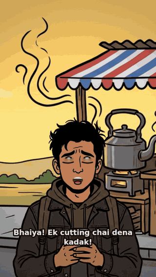

#### The problem v1 solved

[Rigpop Agents](https://github.com/swapagrawal14/rigpop-agents) turns a script into a **talking
bust**: one drawing, mouth patches, a little bounce. Perfect for dialogue — and completely
useless the moment your character has to *walk across a street*.

`rigpop-motion` is the other half. It doesn't animate pixels; it animates **drawings, timing
and camera**.

|  | Cut-out puppet | **Pose flip-book** |
|---|---|---|
| Art | 1 drawing, pieces pivot on bones | 6–8 drawings |
| Overlap artifacts | possible — limbs slide over each other | **none, every frame is complete art** |
| Smoothness | unlimited angles | stepped, and that's the charm |
| Good for | idle · talk · turn · close-ups | **walk · run · action · dance** |

> Rule of thumb: **locomotion = flip-book, conversation = cut-out.** Both live in this repo.

<br>

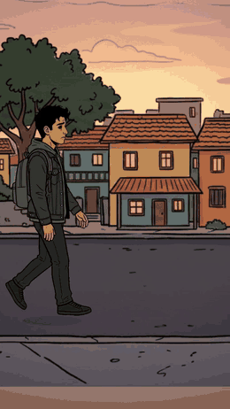

<sub>**six drawings, one walk.** 6 poses × 5 frames @30fps = a 1.0 s cycle, background scroll
matched to stride length so the feet never skate.</sub>

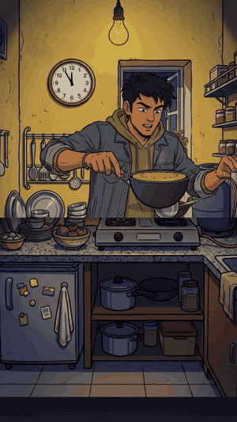

<sub>**five drawings, one dinner.** action is a pose pack too: open the packet → snap the
noodles → stir → sprinkle masala → taste. Light-wrap, a foreground counter and a real entrance
keep him inside the room instead of pasted onto it.</sub>

---

#### v1 quickstart

```bash
npm install
npm run short        # → out/chai-short.mp4   30 s, 720×1280, lip-synced, scored
```

Want just a walk?

```bash
npm run poses        # cut + normalise your generated poses
npm run walk         # flip-book walk on a scrolling street
npm run cutout       # the cut-out puppet alternative
```

Or use the CLI:

```bash
node bin/rigpop-motion.js short   # or: npm run maggi for the 60 s Maggi short
```

---

#### How v1 works

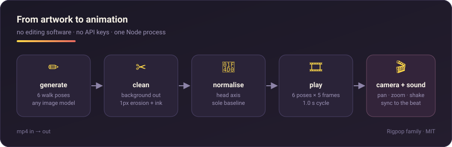

Every stage is one file, no framework:

| Stage | File | What it really does |
|---|---|---|
| **generate** | *your image model* | 6 side-view walking drawings, one per generation |
| **clean** | `src/extract-poses.mjs` | kills every background-coloured pixel, 1 px erosion, re-inks the border |
| **normalise** | `src/extract-poses.mjs` | same body height · head axis on canvas centre · soles on one baseline |
| **play** | `src/flipbook-walk.mjs` | hold each pose 5 frames, scroll the world at stride × cadence |
| **camera + sound** | `src/chai-short.mjs` | pan/zoom/shake, subtitles, footsteps on stride, SFX on the beat |

---

#### What a v1 short looks like

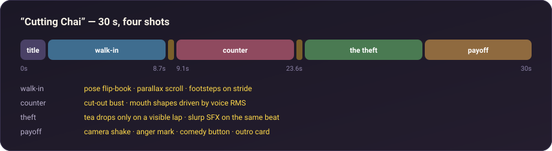

**`out/chai-short.mp4`** — *“Cutting Chai”*, 30 seconds, four shots:

| Time | Shot | Technique on show |
|---|---|---|
| 0–1.7 s | **title** | one background plate, camera pan |
| 1.7–8.7 s | **walk-in** | 6-pose flip-book · parallax scroll · footsteps locked to stride |
| 9.1–16 s | **counter** | cut-out bust · mouth shapes from the voice RMS |
| 16.5–23.6 s | **the theft** | tea level drops **only** on each visible lap · slurp SFX on the same beat |
| 23.6–30 s | **payoff** | camera shake · anger mark · comedy button · outro card |

And the whole soundtrack — 100 BPM ukulele-ish bed, four slurps, two gulps, one guilty meow —
is generated from code in `src/chai-assets.mjs`. No samples, no licences.

#### …and the 60-second one

**`out/maggi-short.mp4`** — *“2 Baje Ki Maggi”*, a hostel comedy in seven shots: a title, a
craving, a tiptoe down the corridor, **him actually cooking the Maggi**, a knock, a warden who
smells the evidence and arrives properly, and a 3 AM payoff. Two characters, three plates, five
cooking poses, one 60 s score that changes act, eleven voice lines and a lip-sync track per actor.

```bash
npm run maggi:prep    # cut the cast, derive mouth patches
npm run maggi:assets  # voice lines, score, foley
npm run maggi         # → out/maggi-short.mp4
```

---

#### The five v1 rules (learned the hard way)

> 1. **Locomotion = pose flip-book.**
>    A cut-out puppet overlaps itself and drags stray props along.
>
> 2. **One pose = one generation.**
>    Ask a model for a 6-pose sheet and the figures end up touching — segmentation becomes
>    impossible. Six separate generations, every time.
>
> 3. **Clear every background-coloured pixel**, not just the flood-filled ring.
>    Enclosed pockets (between a lifted leg and a trouser) survive as halos otherwise.
>
> 4. **Normalise on the head axis and the sole baseline**,
>    or the character drifts and bobs between frames.
>
> 5. **One background plate + camera pan/zoom = several shots.**
>    Cinematic variety for zero extra art.

Each of these is a bug we shipped first. The gory details are in [`docs/SPEC.md`](docs/SPEC.md).

---

#### v1 repo layout

```
bin/rigpop-motion.js     CLI: assets · poses · walk · cutout · short
src/paths.mjs            repo-relative paths
src/audio.mjs            decode → PCM, Edge TTS helper
src/extract-poses.mjs    cutout + normalisation of generated poses
src/flipbook-walk.mjs    pose flip-book walk
src/cutout-walk.mjs      cut-out puppet walk
src/chai-short.mjs       30 s short: shots, camera, lip-sync, subtitles
src/chai-assets.mjs      dialogue, music bed and SFX, generated from scratch
src/maggi-short.mjs      60 s "2 Baje Ki Maggi": cooking pose pack, warden entrance, scoped camera
src/maggi-assets.mjs     Maggi dialogue, music bed and SFX
src/prep-maggi.mjs       cuts and normalises the Maggi cast (kabir-cook, warden)
characters/              pose sets (kabir-side, kabir-cook, street-cat, warden) + talk patches
assets/                  background plates, music bed, SFX
docs/                    hero gifs, diagrams, SPEC
```

**Add a character** = 6 walk poses + 1 front bust with A/E/O/blink patches. That's it; the
engine cuts, normalises and times it for you.

---

### The Rigpop family

- [**rigpop-agents**](https://github.com/swapagrawal14/rigpop-agents) — scripts in, talking videos out
- [**rigpop-talk**](https://github.com/swapagrawal14/rigpop-talk) — the browser app
- [**rigpop-ink**](https://github.com/swapagrawal14/rigpop-ink) — footage that redraws itself as ink
- **rigpop-motion** — full cartoon animation *(you are here)*

<sub>MIT © swapagrawal14 · brand assets regenerate with `node docs/brand/build-brand.mjs`</sub>
